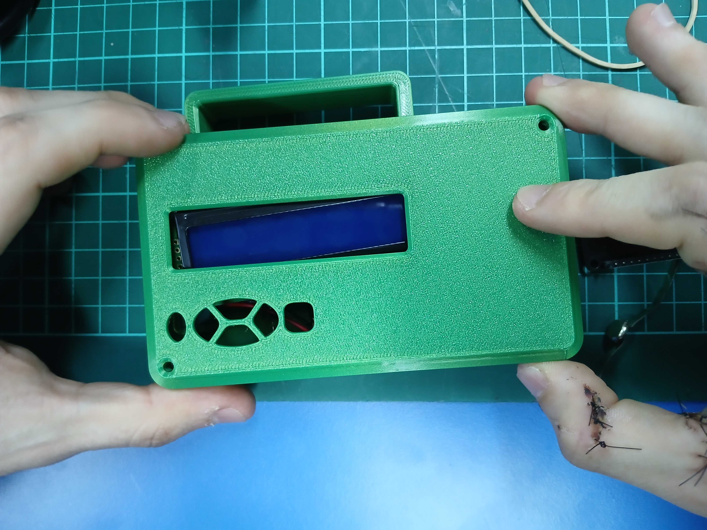

# Informe de Avance 3: Octubre 202x

## 14/10/2026

### Resumen
Debido a la ausencia de los integrantes Nicolas Rodriguez y Agustin Silva, los integrantes Richard Rodriguez y Elian Gutierrez realizaron tareas de monitoreo a los proyectos de los grupos del resto de compañeros.

## 21/10/2026
Hoy miercoles 21 estamos todos los integrantes presentes con el objetivo de presentar el proyecto en el nuevo case

## 28/10/2026
Hoy con todos los integrantes reunidos realizamos la integración del case, la soldadura de los cables al esp32 y la renovación del código, tomando una versión anterior y mejorandola.

## Errores Descubiertos
La batería integrada en el case no da el suficiente voltaje al **esp** para correr el programa.
Al soldar directamente los cables al esp32

- [Incluir:]
  - [Tareas completadas]
  - [Problemas encontrados y soluciones/alternativas propuestas]
  - [Próximos pasos]
## Imágenes del día de hoy

**Esp conectado por cables soldados presentado en el case**

**Fondo del case del esp, muestra la batería y el switch**

https://github.com/user-attachments/assets/3680176b-1536-4c7e-bca9-6e0e30cd18f4

**Video demostración**

